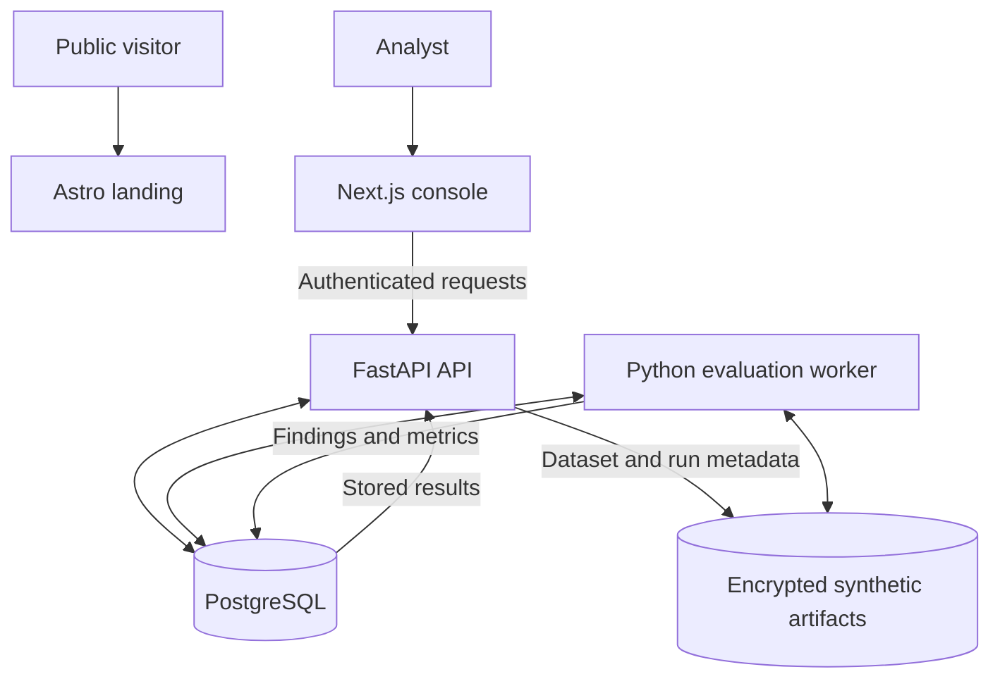
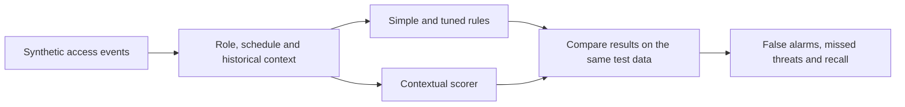

# FishEye

FishEye is a cybersecurity platform that helps banks detect suspicious employee activity while reducing unnecessary security alerts.

It examines activity in context—including normal behaviour, job roles and access history—to help security teams understand which alerts deserve investigation.

**Our goal:** Help analysts distinguish genuine threats from harmless unusual activity, so they can focus on the alerts that matter.

## The problem

Banks monitor access to sensitive systems and customer data. An unusual action can trigger an alert, but an alert is not proof of a threat: it could also be legitimate work or a mistake.

Investigating every alert takes time. FishEye aims to make alerts easier to understand and prioritize while preserving human investigation and judgment.

## What FishEye does

- **Detects unusual activity** using role permissions and normal activity patterns.
- **Explains findings** with evidence and reasons behind each priority.
- **Supports investigations** by letting analysts review findings.
- **Tests effectiveness** by comparing contextual detection with rule-based approaches on the same synthetic data, including false alarms and missed threats.

## Explore the application

| Area | Purpose |
| --- | --- |
| [Landing](apps/web/landing) | Introduction to FishEye |
| [Sign in](apps/web/console/src/app/login) | Access the demo workspace with configured credentials |
| [Scenario lab](apps/web/console/src/app/%28workspace%29/scenarios) | Run bundled or uploaded synthetic scenarios locally |
| [Risk overview](apps/web/console/src/app/%28workspace%29/overview) | View findings from completed runs |
| [Investigations](apps/web/console/src/app/%28workspace%29/investigations) | Examine findings and supporting evidence |
| [Evaluation](apps/web/console/src/app/%28workspace%29/evaluation) | Compare rule-based and contextual results |

The evaluation reports metrics such as false-positive rate and recall. **Detection delay is not available in this version.**

## How the system works



The **API** validates inputs, manages access and records evaluation jobs. The separate **worker** processes synthetic datasets, scores activity and stores findings and evaluation results. The **console** displays that evidence and lets analysts review findings. The frontend does not calculate risk scores.

### Detection and evaluation



FishEye currently uses **explainable, deterministic rules and statistical baselines**, not a trained AI model. It considers signals such as out-of-role access, unfamiliar devices, unusual access volume and activity outside declared working hours. Results show the reasons and events behind findings.

We compare FishEye's contextual scoring with simple and tuned rule-based approaches on the same labelled synthetic data. **Reducing alerts only counts as improvement if genuine threats are still detected.** The current evaluation does not report detection delay.

## Technology and why we chose it

| Technology | Purpose | Why it fits |
| --- | --- | --- |
| **Astro** | Public landing site | Lightweight pages without an unnecessary app runtime |
| **Next.js + React + TypeScript** | Analyst console | Interactive investigation views and typed frontend code |
| **FastAPI + Pydantic** | Backend API | Typed validation and API contracts alongside the Python analysis code |
| **Python + Polars** | Detection and evaluation worker | Efficient processing of synthetic event data and reproducible scoring |
| **PostgreSQL + SQLAlchemy/Alembic** | Run, job and review records | Transactional data, durable job state and versioned migrations |
| **Encrypted Parquet artifacts** | Synthetic datasets and results | Keeps larger analytical data separate from transactional records |
| **Docker Compose** | Local integration | Runs connected services consistently for development and testing |
| **pnpm + Turborepo / uv** | Monorepo tooling | Manages web and Python dependencies in their own ecosystems |

The API and worker are separate processes so longer-running evaluations do not have to execute inside web requests. They share Python libraries rather than introducing separate services for every detector or feature.

For component boundaries, security decisions and implementation details, see [System architecture](docs/ARCHITECTURE.md).

## Documentation

- [Product requirements](docs/PRD.md)
- [Development and testing](docs/DEVELOPMENT.md)
- [Architecture](docs/ARCHITECTURE.md)
- [Design](docs/DESIGN.md)
- [Brand](docs/BRAND.md)

## Run locally

**Requirements:** Node.js 22.22+, pnpm 11.25.0, Python 3.12, uv 0.13.4+, and Docker Compose.

From the repository root:

```bash
pnpm install --frozen-lockfile
uv sync --locked --all-packages --all-groups
cp .env.example .env
```

Configure the demo login, session secret, artifact encryption key and development-only synthetic-data flags in `.env` as described in the [development guide](docs/DEVELOPMENT.md#local-compose-stack).

Then start the local demo:

```bash
docker compose -f infra/compose.yaml --profile application --profile web up --build -d
```

- Landing: http://127.0.0.1:4321
- Console: http://127.0.0.1:3000/login

Sign in using your locally configured demo credentials, then open **Scenario lab** to run a synthetic example. This Compose setup is for **local development only** and must not be exposed publicly.

For detailed environment setup, troubleshooting and tests, see [Development](docs/DEVELOPMENT.md).
